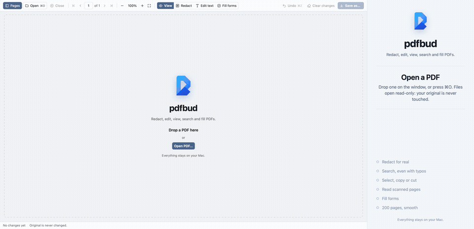

<p align="center">
  <picture>
    <source media="(prefers-color-scheme: dark)" srcset="docs/logo-dark.png">
    
  </picture>
</p>

<p align="center">
  <a href="https://github.com/hfmsio/pdfbud/releases"></a>
  <a href="https://github.com/hfmsio/pdfbud/releases"></a>
</p>

**Redact, edit, view, search and fill PDFs.** Redaction is for real: the text is deleted from the file, not hidden under a black box. It all happens on your Mac. The app has no network code and no tracking, so nothing is uploaded.

## What it does

- **Gone, not hidden.** Text under a black box is deleted from the file. Notes, form fields and links go with it.
- **Find it once, redact it all.** Emails, phones, cards, SSNs, dates, amounts: one click each, then Redact all. Typos don't fool it.
- **Scans too.** One click reads scanned pages. Search and redact them like any other.
- **Copy, cut, paste.** Select text and copy it, scans included. Cut copies it and blacks it out. Copy a box to another page.
- **Fix a line. Fill a form.** Rewrite one line of text. Fill boxes and drop-downs, and they stay fillable.
- **Built for big files.** Smooth through 200 pages. Zoom, pinch, full screen.
- **Hard to hurt yourself.** Files open read-only. Your original is never touched.
- **A proper Mac app.** Light and dark. Drop a file on it and go.



*A short tour: redact, search with typos, read a scanned page, fill a form.*

*Samples: the IRS forms [W-2](https://www.irs.gov/forms-pubs/about-form-w-2) and [W-9](https://www.irs.gov/forms-pubs/about-form-w-9), US government forms filled with made-up data, and the paper [Chain-of-Thought Prompting Elicits Reasoning in Large Language Models](https://arxiv.org/abs/2201.11903) (CC BY 4.0).*

## Install

Apple Silicon Macs, macOS 11 or newer:

```
brew install --cask hfmsio/pdfbud/pdfbud
```

Update with `brew upgrade --cask pdfbud`, remove with `brew uninstall --cask pdfbud`.
Or download `pdfbud-<version>-arm64.dmg` from [Releases](https://github.com/hfmsio/pdfbud/releases), open it and drag pdfbud to Applications. The app is not signed with an Apple Developer ID yet, so macOS blocks the first launch with "Apple could not verify pdfbud". Click Done, not Move to Trash, then either run `xattr -dr com.apple.quarantine /Applications/pdfbud.app`, or open System Settings, Privacy & Security, and click Open Anyway next to the pdfbud message. Run the command after dragging pdfbud to Applications, not from inside the DMG.

## Run from source

You need a Mac with Apple Silicon. Two steps:

```
brew install uv                    # once. Skip it if you already have uv
uv run pdfbud                      # from this folder: the first run fetches what it needs, then the app opens
```

To open a file straight away: `uv run pdfbud file.pdf`. To get a double-clickable app: `./packaging/build.sh`, then open `dist/pdfbud.app`.

## Use it

1. Open a PDF with `⌘O`, or drop it on the window.
2. Press `R`. Click a line or drag a box over what to hide. Or search, click a chip like Emails or SSN, and press Redact all.
3. Press `P` to preview the black boxes, then `⌘S` to save a copy. The original is never changed.
4. To check, open the saved copy, press `⌘F` and search for what you hid. It should find nothing.

## Keys

| Key | Does |
|---|---|
| `⌘O` `⌘W` `⌘S` | Open, close, save as |
| `⌘Z` | Undo |
| `⌘A` `⌘C` `⌘X` | Select the page's text, copy, cut (copy and redact). View mode |
| `⌘C` `⌘V` | Copy the box you clicked, paste it on this page. Redact mode |
| `⌘F` | Search |
| `V` `R` `E` `F` | View, Redact, Edit text, Fill forms |
| `P` | Preview |
| `⌘+` `⌘-` `⌘0` or pinch | Zoom |
| `←` `→` `Home` `End` | Change page |
| `⌃⌘F`, `Esc` | Full screen, leave it |

## Limits

- Reading scans can miss words, and handwriting is hit and miss. Check the page after redacting a scan.
- Selecting text works on lines that read left to right. A scan must be read first.
- Edit text changes one line at a time. Long text shrinks to fit. It does not work on scans.
- Signatures and pictures are not text. Draw a box over them.
- No password-protected PDFs. No radio buttons or signature fields.
- A drawing only partly under a box stays in the file, though the box still covers it on screen. Bookmark titles that quote a redacted word become `[redacted]`.
- Edit text can only write Latin letters. It tells you when a character won't fit.
- The built app is not signed or notarized yet. On another Mac the first launch needs the steps under Install.

## Help

Found a bug or have a question? [Open an issue](https://github.com/hfmsio/pdfbud/issues). Say which macOS you use and what you did, and leave the PDF out if it is private.

## Development

```
uv run pytest                                  # fast tests, no window
uv run ruff check .                            # lint
uv run python tests/ui/window_checks.py        # drives a real window, parked in a screen corner (PDFBUD_SHOW=1 to watch it). Uses your clipboard and puts it back
uv run python tests/ui/open_files_checks.py    # dropping files, Finder open requests
```

## Licence

AGPL-3.0, see `LICENSE`. Uses [PyMuPDF](https://pymupdf.readthedocs.io) (AGPL-3.0 or paid licence from Artifex), [pywebview](https://pywebview.flowrl.com) (BSD-3-Clause), [PyObjC](https://pyobjc.readthedocs.io) and [RapidFuzz](https://github.com/rapidfuzz/RapidFuzz) (both MIT).
